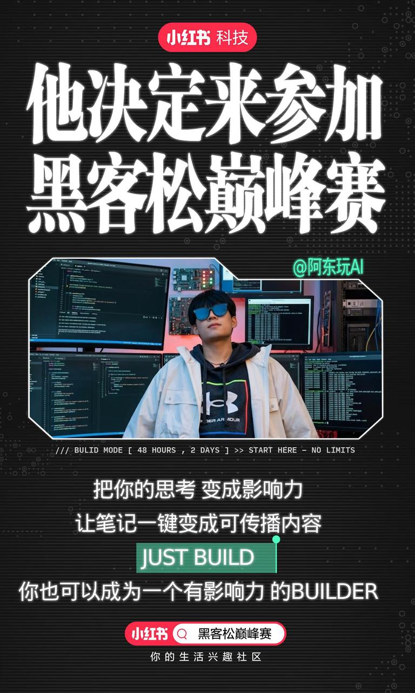
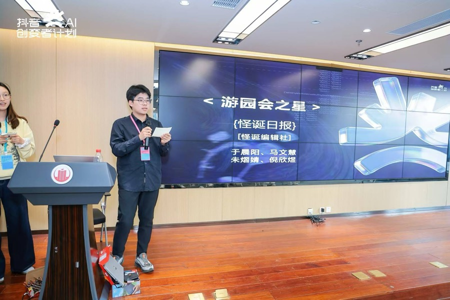
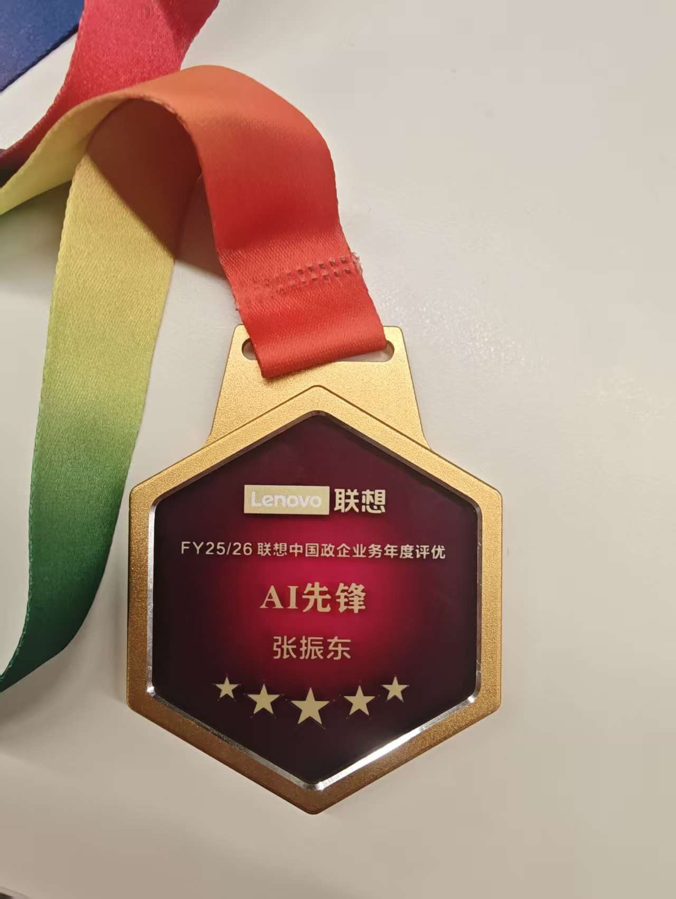
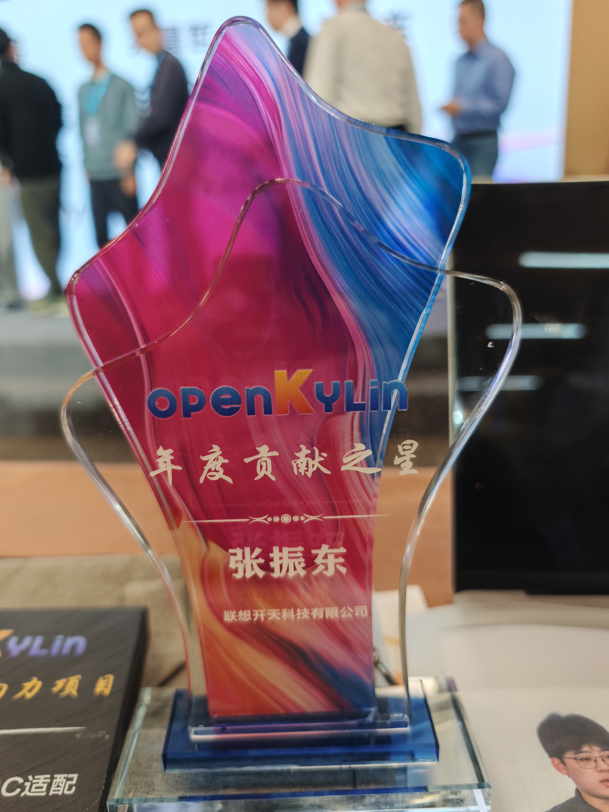

<h1 align="center">Hi, I'm <a href="https://github.com/adongwanai">Adong / 阿东玩 AI</a></h1>

<strong>Router Harness · Harness RSI (Recursive Self-Improvement)</strong> Building products that are fun and useful.

  &nbsp;&nbsp;
  &nbsp;&nbsp;
  &nbsp;&nbsp;
  <strong><big><big>?</big></big></strong>

<strong>BaiDu Senior R&amp;D → Lenovo Agent Architect → ?</strong>

  
  
  

AI master's graduate from the <strong>University of Chinese Academy of Sciences · Institute of Automation</strong>; former <strong>BaiDu Senior R&amp;D Engineer</strong>, now <strong>Lenovo Agent Architect / AI Native Innovation Lead</strong>.

My research focuses on <strong>Router Harness</strong> and <strong>Harness RSI (Recursive Self-Improvement)</strong>: how agents route computation across models and execution environments, and how their harness can improve through execution feedback and evaluation.

Created <a href="https://github.com/adongwanai/AgentGuide">AgentGuide</a> ; first-author research targeting <strong>EMNLP / AAAI</strong>; led an <strong>8-person</strong> Agent engineering team; and drove Agent capabilities into Lenovo's desktop product line.

Built a <strong>1M+ technical audience</strong> across Douyin, WeChat and Xiaohongshu, delivered Agent talks to <strong>300+ Lenovo colleagues</strong>, and received the <strong>Lenovo China AI Pioneer Award</strong> and an Outstanding performance rating.

Currently holding <strong>Agent Algorithm Expert</strong> opportunities from all three BAT companies.

  &nbsp;
  &nbsp;
  &nbsp;
  &nbsp;
  &nbsp;
  

<strong>中文介绍 / Chinese bio</strong>

<strong>中国科学院大学（中科院自动化所）人工智能硕士</strong>，曾任 <strong>BaiDu 高级研发工程师</strong>，现任 <strong>Lenovo Agent 架构师 / AI Native 创新组负责人</strong>。

主要研究 <strong>Router Harness</strong> 与 <strong>Harness 的递归自我改进（RSI）</strong>：面向长程 Agent 任务，研究模型选择、端云协同与执行状态管理，在质量、成本和时延约束下进行逐步路由；利用执行轨迹和评测反馈，探索 Harness 的编排逻辑、工具、记忆与 Skills 如何持续改进，并通过独立任务和可复现实验验证改进是否有效。

发起并主导 <a href="https://github.com/adongwanai/AgentGuide">AgentGuide</a> ；开展 <strong>EMNLP / AAAI 一作研究</strong>，带领 <strong>8 人 Agent 研发团队</strong>，推动 Agent 能力落地联想桌面产品线。

持续在抖音、微信公众号和小红书分享技术实践，技术受众达 <strong>100 万+</strong>；面向 <strong>300+ 位联想同事</strong>开展 Agent 技术分享，获得 <strong>联想中国 AI 先锋奖</strong>与 <strong>Outstanding 绩效</strong>。

目前已获得 <strong>BAT 三家的 Agent 算法技术专家机会</strong>。

<a href="#selected-open-source">Selected work</a> · <a href="#research--engineering">Research &amp; engineering</a> · <a href="#community--impact">Community &amp; impact</a> · <a href="https://adongwanai.github.io/">Homepage</a>

## Research &amp; Engineering

- **Router Harness** — adaptive model selection and edge / cloud routing within the agent execution loop. I study how routing decisions interact with task state, context, tools and recovery over long horizons, balancing task quality, inference cost, latency and privacy.
- **Harness RSI · Recursive Self-Improvement** — using execution traces, failure analysis and evaluator feedback to improve the harness itself: orchestration, prompts, tools, memory, reusable skills and routing policies. I explore propose–test–select loops with fixed base models, versioned changes and rollback, measuring whether improvements transfer to unseen tasks.

**Evaluation approach.** Inspired by [MLE-bench](https://github.com/openai/mle-bench)'s evaluation of agents on machine learning engineering tasks, I prioritize task outcomes under explicit time and compute budgets, held-out evaluation, repeated runs, component ablations and reproducible traces. The aim is to measure whether routing and harness changes lead to reliable gains in quality and efficiency.

## Selected Open Source

<table>
<tr>
<td width="50%" valign="top">

### [AgentGuide](https://github.com/adongwanai/AgentGuide)

An end-to-end guide from Agent algorithms to runnable systems: Runtime, Agentic RL, RAG, data synthesis, tool use and evaluation.

</td>
<td width="50%" valign="top">

### [learn-workbuddy](https://github.com/adongwanai/learn-workbuddy)

An implementation-first desktop Agent Harness covering Agent Loop, Tool, Memory, Context, Sidecar and sandbox auditing.

</td>
</tr>
</table>

- **[hybrid-router-oss](https://github.com/adongwanai/hybrid-router-oss)** — hybrid edge / cloud model routing with quality, cost, latency and privacy as first-class signals.
- **[agent-ready-template](https://github.com/adongwanai/agent-ready-template)** — a Harness-first template for coding agents to understand a repository, follow boundaries and take over development.

## Community &amp; Impact

**1M+ technical audience across multiple platforms.** I share practical work on Agents, LLM systems, training, inference and evaluation through “Adong Plays with AI”.

### Adong's LLM Lab

An open community for LLMs, RAG, Agents, training, inference and evaluation — with learning paths, project notes, paper discussions and engineering exchange.

**[Join the community / read the guide](https://ccn7vpu5l5y8.feishu.cn/wiki/Uu5Pwkcjwio10ZkC82tct3MSn8i)**

### Talks &amp; recognition

Delivered **4 Agent engineering talks to 300+ Lenovo colleagues** and joined multiple AI hackathons as a speaker.

  
  

**Outstanding** · Lenovo China AI Pioneer Award · Annual Professional Contribution Project Award

<strong>More awards &amp; activity records</strong>

- 2025 OpenAtom Developer Conference — Distinguished Contribution Award &amp; invited speaker
- OpenAtom Open Source Community — Contributor of the Year
- CAS MCP Cloud Service Competition — Third Prize
- Algorithm Design &amp; Programming Challenge — Silver Medal

  
  

**[Full activity record](https://ccn7vpu5l5y8.feishu.cn/wiki/XoWQwzCKciMXPJkDjHYckNLAnJc)**

---

[Personal homepage](https://adongwanai.github.io/) · [Open-source discussions](https://github.com/adongwanai/AgentGuide/issues) · [Contact / collaboration](https://ccn7vpu5l5y8.feishu.cn/wiki/XoWQwzCKciMXPJkDjHYckNLAnJc)
